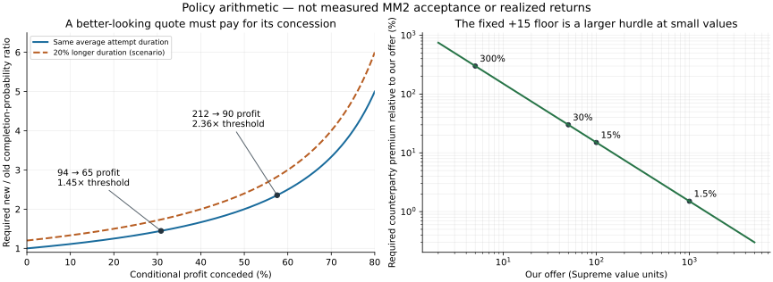

# Improving the current trader's sustained inventory growth

Research date: **November 4, 2026**. Current engineering baseline: [draft PR #14](https://github.com/chazebanks/MM2-AutoTrade-Rebuild/pull/14), commit `b92348125372026393c3815ecabbc8f3be1df32b`. This is a documentation-only continuation of Issue 6 and PR #13. It does not replace tested code or enable acceptance, completion accounting or Discord. The dated market inputs remain the preserved November 3 observations, not newly checked live prices.

## The recommendation

Keep the current safety and execution machinery. Improve the decision layer in this order: **one trade-wide concession ledger; inventory-aware opening quotes with reachable alternatives; consistent risk measures; and preservation of candidates that leave materially different inventory behind.** Then compare those candidates through complete attempt and outcome records. Do not treat higher nominal profit, higher demand, a larger offer or a lower concentration score as the universal winner.

This is more specific than recommending “market-aware trading.” Six experiments using the exact current pure policies demonstrate seven limitations, described below. They establish actual selection behavior; they do not establish which counterparty would accept or how the acquired items would resell. No independently verified completed-trade sample was obtained, so the research cannot honestly identify a statistically proven optimum or an acceptance probability.

The full [November 3 investigation](MM2_DEEP_MARKET_AND_TRADING_RESEARCH_2026-11-03.md) remains useful:190 canonical rows,189 numeric prices,118 cross-list disagreements,801 publisher-history records, source/class anomalies, strategy comparisons and creator/community evidence. Its old Issue 4 band-first/five-second execution model is historical. The current V11 decisions below supersede that model for new experiments.

## 1. Optimize the right outcome

The operational target is **verified Supreme value gained per whole session-hour, subject to +15 on each completed trade and acceptable retained inventory**. Include search, requests, refusals, assembly, native cooldown, failed actions, loading and hopping in elapsed time. An offer is not profit. A completed +15 is a verified list-unit gain, not a cash return or proof the received item can be traded onward at its list value.

Separate three ledgers:

1. Exact completed-trade gain using one frozen Supreme version and proven quantity deltas.
2. Price-list revaluation of unchanged holdings between dated snapshots.
3. Marketability observations: verified subsequent exits, holding time, failed attempts and portfolio composition. Demand/status are source descriptors until those exits can be measured.

For a candidate with conditional completed gain `g`, completion probability `p` conditional on the same starting decision state and expected whole-attempt duration `d` across **all outcomes**, including declines and failures, the one-step comparison is `p*g/d`. This is an analytic comparison, not an estimated model. A concession from profit `P` to `P-c` needs:

`p_new / p_old > [P / (P-c)] * [d_new / d_old]`

when the denominators are positive. At zero baseline completion the ratio is undefined; collect evidence rather than dividing by zero. Real inventory changes make a multi-trade policy more complex than this one-step calculation.

Examples, with **unmeasured** probabilities:

| Comparison | Conditional gain before/after | Required completion-probability ratio if duration is equal |
|---|---:|---:|
| Current early quote 56→85 against 150 |94→65|`>94/65 ≈1.446×`|
| Quote 23 versus 145 against 235 |212→90|`>212/90 ≈2.356×`|
| Previous profit-first give 10→quality-first give 60 against 100 |90→40|More than 2.25×|
| Late concession reducing profit 30→20 |30→20|More than 1.5×|

An extra 20% attempt duration raises each threshold by 20%; that is a sensitivity scenario, not a measured native delay. This is why “more attractive” and “higher demand” alone cannot prove more profit. It also challenges the earlier research's preference for quality-first: the proposed hybrid is a candidate, not a validated winner.

The fixed +15 requirement deliberately creates a large relative hurdle at low values. Giving 5 requires receiving 20, a 300% premium relative to what we give; giving 50 requires 30%; giving 100 requires 15%; giving 1,000 requires 1.5%. Orange Seer 2→Boneblade 7 is a positive+5 example that the current policy correctly excludes. This is the approved constraint, not a bug or permission to lower it. At large values the opposite problem appears: +15 can be tiny compared with published ranges or repricing risk.

## 2. What experienced-trader advice actually supports

The reused primary text is richer than search snippets but remains selected creator material, often promotional:

| Evidence | Compatible lesson | Counterargument or limit |
|---|---|---|
| [Neblio guide,2:15–4:33](https://www.youtube.com/watch?v=nbvaa_Erjww&t=135s) | Demand, item performance and four-slot compactness can matter; upgrades and downgrades serve different needs. | Platform promotional interest; narrated examples are not independently audited settlements. No universal upgrade premium follows. |
| [Maria,0:21–1:04](https://www.youtube.com/watch?v=CQQ589ACJvQ&t=21s) | Demand and consistent small gains can matter more than waiting for one huge advertised win. | No complete attempt denominator or proof of the title's growth path; no optimal floor or timing established. |
| [MrMoogma,2:55–4:35](https://www.youtube.com/watch?v=kJ1X08FKdQg&t=175s) | An upgrade/downgrade cycle can trade compactness for more smalls, then back again. | Advice to pay 20–30% for an upgrade violates our strict profitable-every-leg rule. Do not copy that loss allowance or old prices. |
| [Inspecter,1:39–2:52](https://www.youtube.com/watch?v=8BjBWt8M6TE&t=99s) versus [dysaiina](https://www.youtube.com/watch?v=wEPZkxIo2rk) | Server usefulness may depend on inventory segment and trader intent. | Conflicting public-versus-trading-server advice, no matched performance sample. Do not hardcode a 500-value server switch or wealth filter. |
| [Swirly Blox,5:22](https://www.youtube.com/watch?v=mRZxbl0TWGI&t=322s) | Allowing offers can reveal a counterparty's utility instead of fixing one advertised deal. | An open-ended listing is a different interaction from physically placing an MM2 opener. It does not prove highest-first or waiting-first. |
| [Sudon,0:41/4:18/6:54](https://www.youtube.com/watch?v=K07Mg8sm-ng&t=41s) | Audit how a claimed growth path was obtained. | Begging, friends and fame contaminate the challenge as evidence for anonymous repeatable trading. |
| [TikTok nitronuke,Oct 9](https://www.tiktok.com/@nitronuke/video/7694799049664384286), [shark.boi 41,Oct 5](https://www.tiktok.com/@shark.boi41/video/7693302069762985230) | Distinguish negotiation from generosity/content incentives. | Returned text describes gifts; it cannot calibrate profitable completion rates. |
| [TikTok .brawnilla,Aug 8](https://www.tiktok.com/@.brawnilla/video/7671665676464983316) | Specific collections can matter more to a person than maximum list value. | A common-knife personal challenge is not a universal knife advantage; those items remain outside our eligible universe. |

These transcript/caption/OCR records were reused, not bought again or represented as new manual footage review. Exact retrieval formats and dates are in the [existing source ledger](RESEARCH_SOURCE_LEDGER.md). Reddit full-thread access remains unsupported 403; indexed counterarguments are leads, not verified comments or consensus. A new public-record check still did not expose individual completed-trade proofs. **Verified settlements remain 0.** See the [November 4 source update](STRATEGY_SOURCE_UPDATE_2026-11-04.md).

Supreme's [use guide](https://supremevalues.com/use) separates base value, demand, stability, ranges and flippability. The preserved data show only 5 flippability fields out of 190; the other 185 are missing. Do not turn missing liquidity into zero, a demand rating into a resale probability, or an unchanged published price into evidence of turnover. The dated Watergun series falls 42% over 90 days despite a Stable label at the observation date: status is not a full history or forecast. [Prior series and method](PUBLISHER_HISTORY_2026-11-03.json)

## 3. Seven demonstrated current-policy limitations

All named-value examples below use the dated research/profile inputs with synthetic counterparties and fixture-only native IDs/types. They are not available market offers. The source [manifest](CURRENT_STRATEGY_RUNTIME_SOURCES_2026-11-04.json), [runnable experiments](tools/compare_current_trader_v 11.lua), [derived data](CURRENT_STRATEGY_EXPERIMENTS_2026-11-04.json) and [full output](CURRENT_STRATEGY_EXPERIMENT_RESULTS_2026-11-04.txt) make the claims reproducible.

### 3.1 A useful small add can exclude a larger safe quote

Our inventory is Icecream 145 plus Green Luger 23; their offer is Flowerwood 235. Current `selectInitialOffer` has a 60% ceiling of 141, selects 23 and cannot reach 145 through a late concession capped at 20. Remove only the 23 item and the fallback selects 145, safely leaving+90. Thus an additional owned denomination changes the reachable choice from 145 to 23.

This proves a quote-selection discontinuity. It does **not** prove 145 is preferable: a collector might specifically want Green Luger, and the required improvement in completion rate is substantial. The research recommendation is to inspect the feasible quote/concession graph before selecting a start, preserve disconnected safe alternatives and log the tradeoff. Do not merely raise the 60% ceiling to an arbitrary replacement or spend all surplus down to+15. [Current initial selector](https://github.com/chazebanks/MM2-AutoTrade-Rebuild/blob/b92348125372026393c3815ecabbc8f3be1df32b/pdiddler/pdiddler4_supreme_policy_v7_VERIFIED_STEPS.lua#L247)

Highest-value-first also fails: partner total inventory capacity is only an upper bound on ability, not willingness to surrender it. Keep the 2.5s opponent-first observation and a real verified opener. For an empty opposing offer, choose an eligible single item compatible with partner four-copy capacity and defensible comparable alternatives; do not expose the most valuable holding merely because it exists. No such candidate means bounded observation, not a guessed opener.

### 3.2 Exact offer changes refill a per-signature budget

With a 101-value, demand 1/Stable opposing bundle, swapping its 33-value middle item across three variants changes exact identity without improving these economic summaries. The real early policy chooses gives 7→38→54→65. Each step respects its per-generation 40%/40 cap; cumulative concession is 58 and profit falls 94→36.

This does not violate the current per-signature contract and is not proof of malicious intent. Different items can be genuinely desired despite identical descriptors. Nevertheless, **identity invalidation and economic spending permission should be separate**. A trade-wide ledger should retain verified concessions already made; equivalent edits must not automatically grant a fresh wallet. New economic value can justify reconsideration under an explicit approved budget; safety-driven downward rebalancing remains available. Approval/session signatures must still invalidate on every actual change. [Early policy reset](https://github.com/chazebanks/MM2-AutoTrade-Rebuild/blob/b92348125372026393c3815ecabbc8f3be1df32b/pdiddler/pdiddler4_early_counter_policy_v2_BOUNDED_VALUE.lua#L135)

### 3.3 Base+15 can have less than 15 in a published downside scenario

Beachy 75→Embersickle 90 passes current `tradeDecision` at+15. The preserved research range 85–100 makes the lower scenario+10. The binary numeric decision does not apply that range or the received Fluctuating status as an intake gate.

Keep the base+15 gate independently. Add a separately labelled range/exposure review where authorized, identity-matched range data exist; do not invent a haircut when they do not. Published 85 is not an executable bid, guaranteed floor or complete worst case. Protected review can reduce exposure but also reject profitable opportunities; evaluate both effects. [Current numeric decision](https://github.com/chazebanks/MM2-AutoTrade-Rebuild/blob/b92348125372026393c3815ecabbc8f3be1df32b/pdiddler/pdiddler4_supreme_policy_v7_VERIFIED_STEPS.lua#L99)

### 3.4 A numeric win can remove the portfolio's only stronger-demand anchor

Icepiercer 160/D3→three Ornaments 195/D1 passes+35. If the rest of our inventory is Chroma Darkbringer 65/D1, held value at demand≥3 drops 160→0. The list-value total rises 225→260; the ordinal demand composition weakens.

This proves the composition change, not slower actual resale. Ornaments might suit the next counterparty better. Record the post-trade demand-threshold vector, compact one-to-four-copy capacity and unstable exposure before declaring the candidate attractive. Do not assume a weighted demand average predicts cash or turns per hour. Preserve both knives and guns and avoid a universal Chroma/knife premium.

### 3.5 The planner discards inventory-aware alternatives before ranking

Own Darkbringer 33×1 plus Iceblaster 33×3; receive Ornament 65. Giving either Darkbringer or one Iceblaster gives 33, earns+32, uses one copy and has identical D1/Stable offered statistics. The current DP keeps only the lexicographic Darkbringer alternative. It leaves exact-item HHI0.5215; giving one Iceblaster instead leaves 0.3595. A portfolio-aware ranker cannot recover the discarded option.

The state key contains total, weighted demand and copy-risk, not retained item identity/concentration/set membership. Preserve a bounded representative set when those retained characteristics differ; compare whole portfolios before tie-breaking. Lower HHI is descriptive, not always better: a concentrated liquid anchor may be more useful than diverse hard-to-move filler. [DP state collapse](https://github.com/chazebanks/MM2-AutoTrade-Rebuild/blob/b92348125372026393c3815ecabbc8f3be1df32b/pdiddler/pdiddler4_supreme_policy_v7_VERIFIED_STEPS.lua#L197)

### 3.6 Risk measures disagree between planning paths

The live bundle measure is value-weighted; the planner's `givenRisk` is the fraction of unstable copies. In an isolated late-selector fixture, unstable 90+stable 5+stable 5 has a lower copy-risk than unstable 10+stable 90, so the former ranks ahead despite 90% versus 10% unstable value. Both supplied plans give 100, earn 100 and have the same demand average.

The early policy already recomputes value-weighted risk. Use consistently defined, separately labelled value exposure and copy counts in every path, with status categories retained rather than flattening all non-Stable labels into one economic meaning. This is a demonstrable measurement inconsistency; it is not a measured resale-loss example. [Current planner and late selection](https://github.com/chazebanks/MM2-AutoTrade-Rebuild/blob/b92348125372026393c3815ecabbc8f3be1df32b/pdiddler/pdiddler4_supreme_policy_v7_VERIFIED_STEPS.lua)

### 3.7 A technically stable partial offer may not be a finished offer

P4 cancels after technical stability when no current+15 plan exists; its configured five-second no-plan grace is unused. A player may simply be adding the next item more slowly than the 0.65s stability interval. Conversely, waiting on every impossible offer wastes time.

Test a **single bounded assembly window only before any local approval or unsafe exposed quote**, capped by the existing trade deadline. Offer progress can be observed without infinite resets; accepted-empty and invalidated approval retain immediate safety behavior. The existing five-second field is a possible experiment, not evidence of an optimal duration. Do not reintroduce competing timers or a blanket extra wait on every trade. [P4 coordinator](https://github.com/chazebanks/MM2-AutoTrade-Rebuild/blob/b92348125372026393c3815ecabbc8f3be1df32b/pdiddler/pdiddler4_balancer_SUPREME_v6_VERIFIED_STEPS.lua)

## 4. Proposed decision specification for a separate engineering change

The current policy remains the control. The following is the strongest testable candidate from this evidence, not authorization to deploy it:

1. **Validate first.** Use one immutable authorized price version, exact canonical/raw identity, known eligible classes and owned quantities. Maintain the Supreme integer-cents+15 gate, four-copy conservative limit, actual-slot verification, session fences, native acceptance prerequisites and proven-completion accounting. Research does not relax them.
2. **Describe candidate and retained inventory.** Calculate base profit; published range scenario if available; value by each observed demand threshold; separate stability/status exposures; exact-item concentration; one-to-four-copy compact capacity; usable denominations; and recognized set changes. Missing fields stay missing. Do not add set values to component totals.
3. **Keep the relevant alternatives.** Avoid pruning two plans with equal giveaway statistics when retained portfolios differ. Use bounded Pareto/representative retention, stable raw-ID tie-breaking and explicit budget exhaustion. Dominance requires comparable counterparty appeal; unknown preference cannot be declared dominated solely by our profit or demand score.
4. **Select a defensible opening region.** Use partner capacity as feasibility, not intent. For an actual opposing bundle, inspect safe candidates and permitted concession edges before choosing. If the capped region leaves only a tiny disconnected quote, log alternatives and use an explicit preapproved firm-quote mode or bounded review. Research cannot determine the best numeric threshold or silently authorize the high quote.
5. **Keep a single spending ledger.** Track proposed versus physically verified actions, first verified quote, cumulative voluntary concessions, global late-step count and economic context. Exact offer edits always revalidate identity, but do not automatically erase spending. A safe hold remains a valid choice; silence is ambiguous.
6. **Replan for meaningful changes.** Additions/removals invalidate old approvals and require exact revaluation. Preserve a safe current quote when no justified change is needed. Lower our offer or decline to restore safety when theirs shrinks; do not automatically give back every increase when theirs grows. Avoid remove/re-add for economically identical no-ops.
7. **Make concessions pay their cost.** Consider raw surplus surrendered, retained quality, additional native cooldown and observed response. Preserve the current 9s verified-offer wait, clear native ACCEPT and 2.5s ready buffer. No source establishes a better universal wait. At most the approved verified steps; then bounded final observation/decline. Do not infer dissatisfaction from silence alone.
8. **Measure before promotion.** Shadow-score alternatives without actions first; then supervised comparison with complete attempts, frozen inputs, verified completions and exit observations. Start with one decision variable. Native automatic final acceptance/completion/Discord stay disabled until their separate evidence gates are met.

## 5. Upgrades, downgrades, sets and sustained growth

A compact upgrade can improve the value representable in four copies and reduce the number of future matches needed. A downgrade can create useful denominations and more counterparties, or can leave four low-demand items nobody wants. A set can serve someone's collection, but the inspected published set totals equal component sums; no automatic extra premium is justified. A stack can be useful or a concentration problem; four GUI slots alone do not prove unlimited safe quantities.

Our strict profitable-every-leg constraint excludes the common human tactic of taking a small list loss to obtain a desirable anchor, even when the overall round trip might win. Do not secretly implement that exception. Compare only feasible+15 legs and measure subsequent exits rather than extrapolating from a narrated “bought for 1,300, sold for 1,400” cycle.

The proposed portfolio measures should preserve useful trading options, not enforce maximum diversification or a named-item wishlist. A useful audit question is: **after receiving this bundle, what can we feasibly offer next within four copies, while keeping+15 and acceptable source confidence?** Answering that structurally is possible now; predicting the next person's acceptance is not.

## 6. Efficiency without sacrificing reliability

Reduce avoidable work: reuse plans by inventory/profile/economic input versions, cache canonical resolution, preserve verified no-op offers, detect impossible current plans promptly after the bounded assembly decision, and stop old callbacks. Do not shorten native cooldown, remove identity checks or guess unloaded UI to appear fast.

For four owned units there are at most 15 nonempty subsets. A heavy optimizer or learned model is unnecessary for that case. Large inventories require a hard state budget, representative pruning and honest “budget exhausted” outcomes. The 50,000-state limit is explicit; hitting it means no validated optimum is returned. Raising the limit alone is not a strategy or a demonstrated iPad performance improvement. Native profiling must separate planner compute, inventory RPC, parsing, rendering and cooldown costs before optimization.

Measure server discovery through unique eligible counterparties, responses and verified gains per whole session, including travel/loading costs. The newly inspected [Colbe July 30 video](https://www.youtube.com/watch?v=Mu4YP112o3w) warns that normal players also join updates and proposes old-server/bot explanations. Those are creator hypotheses, not a labelled prevalence or market-opportunity study. Keep the working gate/hopper controls; this research does not retune bot detection or adopt occupancy/appearance/level shortcuts.

## 7. Ranked next work

| Order | Change to evaluate | Evidence strength and benefit | Main cost / required test |
|---|---|---|---|
|1|Trade-wide concession accounting; retain identity-generation invalidation|Actual repeated-signature economic experiment; prevents unintentional repeat spending|Can refuse a useful genuine improvement; test equivalent edits, value changes, failed verification and safety rebalances|
|2|Consistent risk metrics and preservation of retained-inventory alternatives|Actual source-key collapse and synthetic measurement inversion|More state; test equal-stat identities, weights, quantity, set/denomination and budget exhaustion|
|3|Quote-grid-aware starting region/firm-quote experiment|Actual 23/145 discontinuity|Larger quote can surrender unnecessary surplus; compare the full frontier and break-even bounds, not a guaranteed win|
|4|Range/status/anchor intake review|Dated primary range plus exact numeric/portfolio counterexamples|May reject profitable trades; keep scenarios distinct from executable exits and measure missed opportunities|
|5|Initial partial-offer assembly experiment|Confirmed current path; human completion intent is unknown|Additional time; bounded only before approval/unsafe exposure, retain hard deadlines|
|6|Outcome/exit/session measurement and matched strategy comparison|Required to determine actual effectiveness|Native proof/access remains the blocker; never train on asks, gifts, GUI closure or selected winners|

The [experiment protocol](STRATEGY_EXPERIMENT_PROTOCOL_2026-11-04.md) specifies denominators, events, comparisons and promotion gates. Continue to preserve PR #14's verified-action lifecycle, physical clicks, rotation, readiness and hopping. Runtime changes belong in a separate draft engineering PR after review; this research update changes none.

## 8. Boundaries of the conclusion

This research does not establish current executable prices, calibrated liquidity, actual acceptance rates, an optimal opening fraction, a universal demand/knife/set preference or a guaranteed growth timeline. It does establish several weaknesses in the current decision representation and provides falsifiable alternatives. Broad repeat scraping cannot fill the missing unbiased attempt and exit data. The source-access/permission limits are retained; no additional bulk Supreme collection, inaccessible community bypass or invented transaction data was used.
