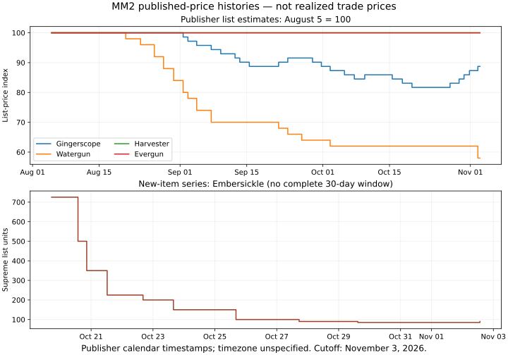

# Issue 6 research pack

Documentation/data only; preserved engineering checkpoint:
`4b5c6d9095d21643349cee32d43719e515e294d1` (draft PR #5).

Research cutoff and engineering baseline: November 3, 2026 / Issue #4. Later
engineering work, including PRs #7–#12, requires its own current review. Timing
recommendations here, including five-second negotiation and twelve-second empty
windows, do not override subsequently verified native cooldown evidence.

- [Main investigation](MM2_DEEP_MARKET_AND_TRADING_RESEARCH_2026-11-03.md)
- [All 190 canonical rows](ELIGIBLE_ITEM_MARKET_MATRIX_2026-11-03.csv) and
  [machine-readable data/summary](MARKET_DATA_2026-11-03.json)
- [Goal-agnostic strategy specification](PDIDDLER_TRADING_STRATEGY_SPEC.md)
- [Separate personal roadmap](GINGERSCOPE_PERSONAL_ROADMAP.md)
- [Source ledger](RESEARCH_SOURCE_LEDGER.md) and
  [machine provenance](RESEARCH_PROVENANCE_2026-11-03.json)
- [Implementation priorities and gates](IMPLEMENTATION_PRIORITY.md)
- [Publisher histories](PUBLISHER_HISTORY_2026-11-03.json),
  [set observations](SET_OBSERVATIONS_2026-11-03.json),
  [quarantined extra source rows](UNMAPPED_SOURCE_ROWS_2026-11-03.json),
  [synthetic common-constraint fixtures](STRATEGY_COMPARISON_FIXTURES.json)



## Reproducibility and limits

```sh
PYTHONDONTWRITEBYTECODE=1 python3 research-notes/tools/validate_research.py
python3 research-notes/tools/plot_publisher_history.py
```

The optional builder consumes previously retrieved HTML in an explicit input
directory; it makes no network requests. Raw third-party page bodies/transcripts
are not redistributed. Its input filenames and source hashes are recorded in
the code/provenance; publication-basis reuse is explicit. Supplied structured
datasets allow recalculating windows and synthetic feasibility without acquiring
the raw pages. Source terms/permission must be resolved before production reuse.

No completed-transaction backtest or measured acceptance model exists in this
pack. Verified completions obtained:0. Flippability is known for5/190 rows;
185 fields remain missing. Native type is not established by source filtering.
Runtime automatic acceptance/completion/Discord remain disabled as documented in
Issue #4. No runtime files, objectives or personal target preferences were changed.
